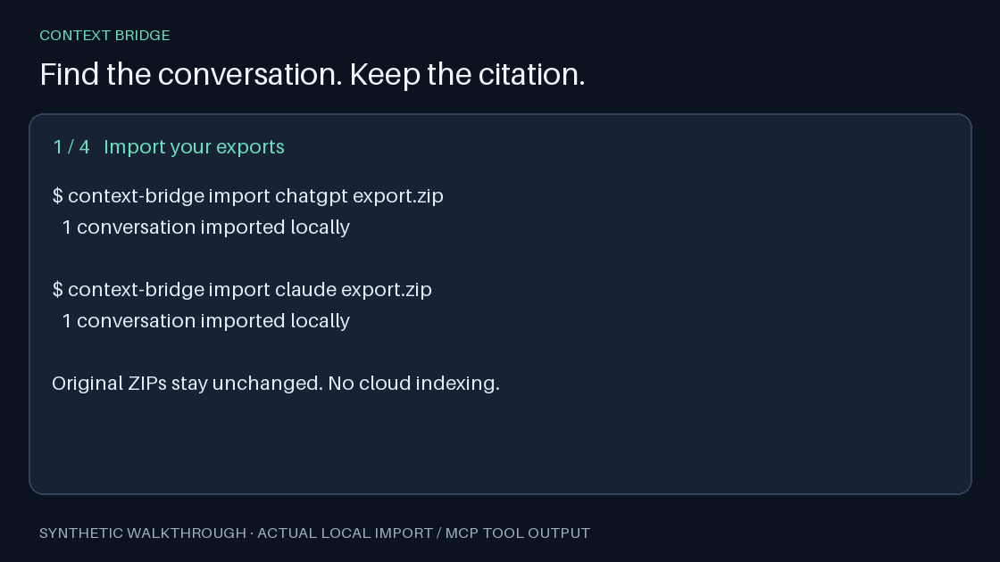

# Context Bridge

**Find what you decided in past Claude and ChatGPT conversations, with citations.**

Import your exports, connect an MCP client, and ask: “What did I decide about Kafka retries last week?” Search stays on your computer. Results link to the original web conversation or an exact local transcript passage.



**Release candidate: 0.6.0a1.** Apache-2.0 · Python 3.9–3.13 · macOS and Linux · local-first · no Context Bridge telemetry. This checkout is not yet published to PyPI or the MCP registry. CI is configured; its remote runs are pending repository publication.

## Quickstart

With an official ChatGPT or Claude export ZIP already downloaded, install this checkout:

```sh
python3 -m venv .venv
.venv/bin/python -m pip install .
.venv/bin/context-bridge import chatgpt /path/to/export.zip
```

For Claude.ai instead:

```sh
.venv/bin/context-bridge import claude /path/to/export.zip
```

Connect Claude Code (replace the executable path with your installation's absolute path):

```sh
claude mcp add --transport stdio context-bridge -- /absolute/path/to/.venv/bin/context-bridge mcp
```

Ask: **“Use context_search to find what I decided about Kafka retries. Cite the conversation link, and read the surrounding passage if needed.”**

There is no required source/reader window split. Every client using this local library searches the same approved imports. [All client setup instructions](docs/CLIENTS.md).

## Existing Claude Code conversations

Preview the projects available on this machine:

```sh
.venv/bin/context-bridge import claude-code
```

Approve the displayed list at the prompt, or select one project explicitly:

```sh
.venv/bin/context-bridge import claude-code --project 'EXACT_PROJECT_NAME' --yes
```

Nothing is imported without approval. Session titles come from Claude Code's `ai-title` records when available. The optional `context-bridge start` manager creates and approves live Claude Code sessions; those sessions refresh automatically when searched.

## What you get

| Tool | Result |
| --- | --- |
| `context_search` | Relevant redacted passages with title, provider, date, conversation link and opaque record ID |
| `context_read` | A larger or question-focused passage, with pagination and changed-record checks |

ChatGPT imports follow the active message-tree branch. Claude.ai imports human/assistant text. Tools, thinking blocks and internal replayed API requests are excluded. Re-importing a new export updates the conversation without duplicate messages. Export imports are snapshots; they do not capture new browser chats automatically.

Web citations open `chatgpt.com/c/<id>` or `claude.ai/chat/<uuid>` and require your normal provider access. Claude Code citations use `urn:context-bridge:record:<id>` handles resolved by `context_read`. They are not browser URLs. The MCP interface does not expose local filesystem locators. [Passage behavior](docs/PASSAGE-READING.md).

Search retrieves recorded statements; it does not establish that those statements are true. Explicit recency words influence ranking, but arbitrary date-range filtering is not implemented.

## Local-first privacy

- No Context Bridge account, hosted storage, analytics or usage telemetry.
- Indexing and default SQLite FTS5/BM25 search run locally, with no required runtime dependencies or cloud embedding calls.
- Recognized credentials are redacted before indexing and again on MCP output. Pattern matching cannot detect every arbitrary secret.
- Only explicitly imported or approved conversations are available. Original export ZIPs and Claude Code transcripts are not modified.
- Selected results are sent to your MCP client. If that client uses a cloud model, the provider receives those passages under your account settings.
- The database is plaintext. Local filesystem access can expose its content. Revocation prevents new retrieval; it cannot recall prior model responses.

Default macOS storage is `~/Library/Application Support/ContextBridge`; Linux uses `$XDG_DATA_HOME/context-bridge` or `~/.local/share/context-bridge`. Run `context-bridge paths`, or set the same absolute `CONTEXT_BRIDGE_HOME` for imports and MCP. [Security policy and boundaries](SECURITY.md).

## Test it

```sh
PYTHONPATH=prototype python3 -m unittest discover -s prototype/tests -v
PYTHONPATH=prototype python3 prototype/benchmark.py --messages 100000 --runs 30
```

The tests and benchmark use invented conversations. Model-dependent tests skip without optional local assets. On the development Mac, the 100,000-message synthetic benchmark measured **117 ms p95** for warmed lexical search including refresh, against a 300 ms target; initial indexing took about 6 seconds. Results depend on hardware and workload. [Verification details](docs/MILESTONES.md).

## Distribution

The executable is `context-bridge`; the distribution name is **`context-bridge-local`**. The PyPI name `context-bridge` belongs to an unrelated project.

Before publication, uv users can run this checkout with:

```sh
uvx --from . context-bridge --help
```

After this release is published, the explicit package form will be:

```sh
uvx --from 'context-bridge-local==0.6.0a1' context-bridge mcp
```

The second command is a release target, not a claim that the package is already available. [Release and registry process](docs/RELEASING.md).

## Contribute

Bug reports with small synthetic examples are especially useful. See [contributing](CONTRIBUTING.md), [architecture and SDK decision](docs/ARCHITECTURE.md), and [third-party notices](THIRD_PARTY.md).

Research is frozen while the import/search product ships. Historical model comparisons and claim-support work live under [research](research/README.md). The claim-support checker is not part of MCP search.

Original project code is licensed under [Apache-2.0](LICENSE).
