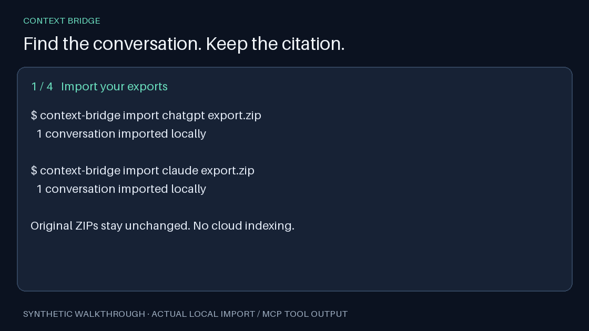

# Context Bridge

**Search past ChatGPT, Claude and Claude Code conversations from one tool, with citations.**

**Why:** Claude and ChatGPT each have memory, but their built-in memory does not search each other's chats or your Claude Code terminals. Context Bridge searches the conversations you explicitly import or approve across those tools.



0.10.0b1 · Apache-2.0 · Python 3.9–3.13 · macOS and Linux · local-first · no telemetry

## Try it in 60 seconds

```sh
uvx --from context-bridge-local context-bridge demo
```

See three cited searches over ten invented conversations. The demo runs offline after package installation, removes its files, and never touches your library. Need uvx? [Install options](docs/INSTALL.md).

Then try your own Claude Code history—choose which projects to approve:

```sh
uvx --from context-bridge-local context-bridge import claude-code
claude mcp add --transport stdio context-bridge -- uvx --from context-bridge-local context-bridge mcp
```

Start a new Claude Code session and ask: **“Use context_search to find a past deployment decision. Cite the source, and use context_read for surrounding turns.”** New sessions in approved projects are discovered automatically.

## Better recall

```sh
uvx --from context-bridge-local context-bridge semantic enable
```

`context-bridge semantic enable` downloads about 90 MB once, then searches locally and offline. Imports offer it once in an interactive terminal. Choosing “no” is remembered. Optional packages and model setup need network access. [Setup details](docs/INSTALL.md#semantic-search).

## ChatGPT, Claude.ai and desktop conversations

Import an official data export:

```sh
uvx --from context-bridge-local context-bridge import chatgpt /path/to/export.zip
uvx --from context-bridge-local context-bridge import claude /path/to/export.zip
```

For ChatGPT desktop / Codex, approve local projects instead—no export:

```sh
uvx --from context-bridge-local context-bridge import codex
```

Connect [ChatGPT desktop, Claude Desktop or Cursor](docs/CLIENTS.md). [Profiles, account checks and removal](docs/USAGE.md).

## Save tokens

Reuse can be cheaper than repeating research—but lookups also cost context tokens. Run `context-bridge savings --explain` for local estimates, or `context-bridge benchmark --savings` for a free, offline synthetic comparison. `context-bridge repeats` shows local repeat-research opportunities with title-only samples and optional review, not proof of savings. The risk-weighted agent guide offers economical, balanced (default) and cautious presets, choosing REUSE, CHECK or REDO according to risk rather than savings alone. Query text is not logged by default. `context-bridge agent-guide` prints reusable consultation instructions; an [optional, bounded Claude Code hook](docs/USAGE.md#automatic-consultation) checks history on prompts. [Methods, negative cases and reproducible results](docs/benchmarks/savings.md).

## How is this different?

- [claude-historian-mcp](https://github.com/Vvkmnn/claude-historian-mcp) searches Claude Code history. Context Bridge also imports ChatGPT and Claude.ai exports and approved desktop/Codex threads.
- Built-in Claude and ChatGPT memory operate within their own products. Context Bridge provides cross-tool search with links or opaque record citations back to the recorded conversation.
- The index stays on your machine, has no telemetry, and searches only imported or approved sources. Retrieved passages are shared with your AI client; a cloud model provider receives the passages you retrieve.

## Privacy and results

Search returns recorded evidence, not verified facts. Recognized secrets are redacted, but pattern matching cannot detect every secret. The local database is plaintext. Removal prevents future retrieval; it cannot recall previous answers. [Security boundaries](SECURITY.md).

Results are grouped by conversation. `context_read` returns surrounding indexed turns with pagination. ChatGPT imports follow the active branch; tool output, thinking and known injected context are excluded. [Usage and sources](docs/USAGE.md) · [Passage reading](docs/PASSAGE-READING.md).

## Contribute

[Installation](docs/INSTALL.md) · [Contributing](CONTRIBUTING.md) · [Roadmap](docs/ROADMAP.md) · [Architecture](docs/ARCHITECTURE.md) · [Verification](docs/verification/0.9.0b1/README.md) · [Third-party notices](THIRD_PARTY.md)

Tests use synthetic conversations: `PYTHONPATH=prototype python3 -m unittest discover -s prototype/tests -v`. Historical experiments are [archived](research/README.md) and are not public CLI commands. Original project code is licensed under [Apache-2.0](LICENSE).

<!-- mcp-name: io.github.ModernFarm-hub/context-bridge -->

The [public-document benchmark](docs/benchmarks/savings-real-guide.md) provides a preregistered, isolated comparison of balanced reuse with fresh research. Its current report uses fake provider responses only; it does not establish measured token savings.
